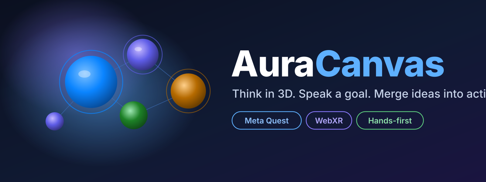

# AuraCanvas — Spatial Mind-Map Studio for Meta Quest



Think in 3D. Speak a goal and a constellation of idea orbs blooms at arm's
reach. Grab one orb, hold it next to another, and the two fuse into a concrete
action plan. Poke an orb to break it into next steps, ask Aura to review blind
spots, then export the board as a Markdown plan you can execute.

AuraCanvas is a hands-first WebXR productivity app built with Three.js. It runs
in passthrough mixed reality and full VR on Meta Quest 3/3S, and in a desktop
3D mode for testing without a headset.

Repository: https://github.com/sandman-sh/AuraCanvas.git

## Features

- Hands-first interaction — pinch to grab, drag to move, bring two orbs
  together to merge, poke to expand. Touch controllers work as a fallback with
  haptic feedback, and a head-direction dwell pointer covers the no-hands case.
- Live AI reasoning — goals become constellations, merges become synthesis
  nodes, and reviews surface blind spots, premortems, and root causes.
- Fully automatic AI over your own `.env` key — no browser setup, no prompts,
  no pasting keys, nothing to connect.
- Honest status badge — it always shows which model is answering right now
  (for example Muse Spark, Gemini, GPT, or Offline).
- Offline engine — goal mapping, merges, expansions, and all three review
  lenses keep working with no network at all.
- Board management — auto-save on every change including each orb's position,
  restore on launch with the layout intact, open/rename/delete with paging in
  the in-headset LIB panel, plus undo, narrated Present walkthroughs, and
  Markdown export with system share-sheet support.
- Comfort by design — seated (68 cm, close/low) and standing (95 cm, far/high)
  reach profiles applied to workspace, keyboard, dock, and panels; recenter
  moves the content anchor itself; captions on by default; reduced-motion
  respected.

## How the AI works

Every agent call (generate, merge, expand, review) goes to the server route
`/api/agent`, which tries Meta, then Gemini, then OpenAI using the keys from
the server environment. The first tier that returns usable nodes wins. There
is no key UI anywhere in the app — the browser never sees, stores, or sends
any API key.

If no server key is set, or every provider fails, the offline engine answers
instead: a local goal parser that maps your words into goal, strategy,
product, growth, and risk nodes. The badge simply reads Offline in that case.

## Quick start

Requirements: Node.js 18 or newer.

```bash
git clone https://github.com/sandman-sh/AuraCanvas.git
cd AuraCanvas
npm install
cp .env.example .env
```

Then open `.env` and paste your key (get one at https://dev.meta.ai → API
keys):

```ini
META_API_KEY=paste-your-key-here
META_MODEL=muse-spark-1.3
```

`.env` is git-ignored and never committed. Then:

```bash
npm run dev      # open http://localhost:5173
npm run build    # typecheck + production build -> dist/
```

With `META_API_KEY` set, all AI features work immediately — the app never
asks you for a key, and there is no key screen to connect.

## Verify the AI end to end

With the dev server running, this request exercises the full server chain
(key → provider → sanitized nodes) without touching the UI:

```bash
curl -X POST http://localhost:5173/api/agent \
  -H "Content-Type: application/json" \
  -d '{"action":"generate","prompt":"Launch a neighborhood coffee cart"}'
```

A working setup returns `"provider":"meta"` with five nodes. If you see
`"provider":"local"`, the server key is missing or the provider call failed —
check the terminal: the dev server logs which keys it loaded (names and key
lengths only, never values) and why a provider call fell through.

## Try it without a headset (3 minutes)

1. `npm run dev`, open http://localhost:5173, click **Launch Desktop 3D**.
2. Two tutorial orbs appear. Drag one into the other — Aura awakens and asks
   for your goal.
3. Type a goal in the bottom bar and press Enter, or tap an example pill.
4. Double-click an orb to expand it. Press Review (or poke Aura in XR) for a
   blind-spot scan — subsequent reviews cycle through premortem and five
   whys.
5. Press Export to download the Markdown action plan.

## Try it in XR with the Immersive Web Emulator

1. Chrome → install the **Immersive Web Emulator** extension.
2. DevTools → WebXR panel → emulate **Quest 3**, enable hand tracking.
3. Open http://localhost:5173 (localhost counts as a secure context).
4. Click **Enter Mixed Reality**. Pinch both tutorial orbs and bring them
   together — golden fusion burst, Aura wakes and asks for your goal.
5. Dictate or poke-type your goal (ABC key), merge orbs, poke LIB for saved
   boards, poke CTR to recenter. Park your hands out of view to verify the
   head-direction dwell fallback.

## Controls

Desktop 3D:

- Drag an orb to move it (release has a short inertial glide), drag one orb
  into another within ~18 cm to merge, double-click to expand, drag the
  background to orbit, scroll to zoom.

In-headset (seated or standing, no controllers required):

- Pinch near an orb to grab (cursor turns green), release to drop. Bring two
  orbs within ~18 cm to fuse — one-handed drag-into-stationary works.
- Poke an orb to select and expand it. Poke Aura (or SCAN) to review. Poke
  dock buttons: VOX voice, ABC keyboard, LIB boards, ORG organize, SCAN
  review, MD export, FX example, CTR recenter, SAVE save.
- LIB board panel: poke a board to open (pager rows appear past three
  boards), + New for a fresh board, Rename on its own row, Delete with a
  two-step poke confirm. Present and Undo live there too.
- In-headset keyboard: poke ABC, hold each key ~350 ms to type (progress
  grows on the key, no repeat until lift-off), GO to submit. Edits goals,
  card titles, summaries, actions, and board names.
- No hands tracked: hold your head still to dwell-select keyboard keys, board
  rows, dock buttons, orbs, and Aura. This is head-direction dwell, not eye
  tracking.
- Seated vs standing toggle on the landing page rebuilds the whole layout at
  the matching reach — workspace, keyboard, dock, and panels.

## Deploy to Vercel

1. Push to GitHub, then Vercel → New Project → framework **Vite**, output
   directory `dist` (already set in `vercel.json`).
2. Set `META_API_KEY` in the Vercel project environment (fallbacks:
   `GEMINI_API_KEY`, then `OPENAI_API_KEY`). Without keys, `/api/agent`
   serves the offline fallback and never errors.
3. Open the deployed HTTPS URL on Quest 3/3S → Enter Mixed Reality.

## Project structure

```text
api/agent.ts            Serverless agent route (Meta → Gemini → OpenAI → offline)
src/main.ts             App wiring, XR frame loop, persistence, board actions
src/xr/                 Scene, orbs, Aura core, dock, keyboard, board panel,
                        hands, particles, desktop input
src/ai/                 Agent client chain, offline engine, presets
src/speech/             Voice input (Meta transcribe → Web Speech → typed)
src/audio/              Procedural Web Audio feedback (no audio assets)
src/utils/              Board store (validated, honest save status), Markdown export
public/                 Favicon, web manifest
docs/banner.svg         README banner
```

## Troubleshooting

- Badge says Offline engine but you set a key — restart `npm run dev` after
  editing `.env` (keys load at startup), then run the curl check above. The
  terminal shows which keys loaded and why a provider fell through.
- Save failed — browser storage is unavailable (private mode, quota). Boards
  stay in memory; Export still works. Free space or leave private mode.
- Mic unavailable — Quest Browser has no Web Speech API, so dictate on a
  desktop browser or poke-type with the ABC keyboard in-headset.
- Session blocked — use the Immersive Web Emulator extension or Desktop 3D.
  `localhost` is a secure context, so XR works there.
- Key rejected (401/403) — check the key at dev.meta.ai. Model not found
  (404) — use `muse-spark-1.3`.

## Security and privacy

- `.env` is git-ignored (see `.gitignore`) — keys never enter the repo.
- No keys in the browser: the app never stores, shows, or sends an API key
  from the frontend — every AI call goes through the server, which reads
  `.env` (local dev) or the hosting provider's environment (deployed).
- Boards save to the device's `localStorage`. Nothing leaves the device
  except agent requests to the configured provider.

## License

Released under the MIT License — see [LICENSE](LICENSE).
